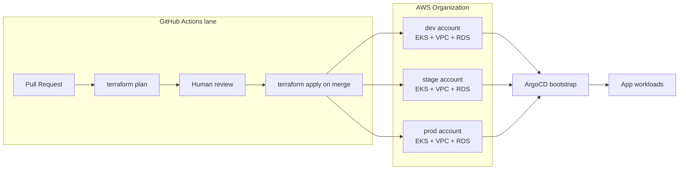

# aws-fleet-platform

**Multi-account, multi-region AWS platform factory — Kubernetes the way platform teams build it.**

This is a reference implementation of the patterns I run in production at enterprise scale
(60+ AWS accounts, 5 regions): composable Terraform modules, environment stacks as thin
callers, GitOps-friendly cluster builds, and CI lanes that make every change flow through
plan → review → apply.



## What's in it

| Layer | Path | Purpose |
|---|---|---|
| Modules | `modules/vpc`, `modules/eks`, `modules/rds`, `modules/kms` | Reusable building blocks, versioned as a module library |
| Environments | `environments/{dev,stage,prod}` | Thin per-env callers — *the only files teams edit* |
| CI/CD | `.github/workflows/` | PR lane: fmt-validate-plan; merge lane: apply |
| Docs | `docs/` | Bootstrap guide, module reference, decisions (ADRs) |

## Principles baked in

1. **Environments are copy-paste** — new env = new folder + tfvars. Same pattern a platform team uses to stamp out client accounts.
2. **Everything through PRs** — no laptop applies. CI runs `terraform plan` on every PR; apply only on merge to main.
3. **Remote state + locking** — S3 + DynamoDB per environment. States never shared between envs.
4. **Least privilege by default** — separate roles per env; no wildcard IAM.
5. **Cost-visible** — tagging standard enforced at module level, so every resource is attributable.

## Quick start

```bash
# clone + set your AWS creds (any sandbox/dev account works)
cp environments/dev/terraform.tfvars.example environments/dev/terraform.tfvars

# review the plan locally
cd environments/dev
terraform init && terraform plan

# or push a branch and let CI plan it for you
```

> Full bootstrap (state buckets, DNS, OIDC provider for GitHub Actions): see [docs/bootstrap.md](docs/bootstrap.md)

## Status / roadmap

- [x] Repo layout + module skeletons + CI lanes
- [x] VPC module (endpoints, flow logs, public/private subnets)
- [x] EKS module (managed nodegroups, IRSA, autoscaler)
- [x] RDS module (Postgres, encryption, final snapshot guard)
- [x] Bootstrap docs + ADR folder
- [ ] Example app-of-apps ArgoCD bootstrap
- [ ] Multi-region (second provider block) example
- [ ] Cost report workflow (scheduled, per-env)

## Why this repo exists

Infrastructure-as-code repos at real companies look like this — not monolithic `main.tf`s.
If you're hiring for a platform/DevOps role and want to see how I structure Terraform at
fleet scale, start here, then look at [gitops-fleet-demo] and [aws-cost-auditor].

_(This is a personal reference implementation inspired by my enterprise platform work.
No proprietary code, client names, or data. All figures in my portfolio are from publicly
shareable experience descriptions.)_

## License

MIT
